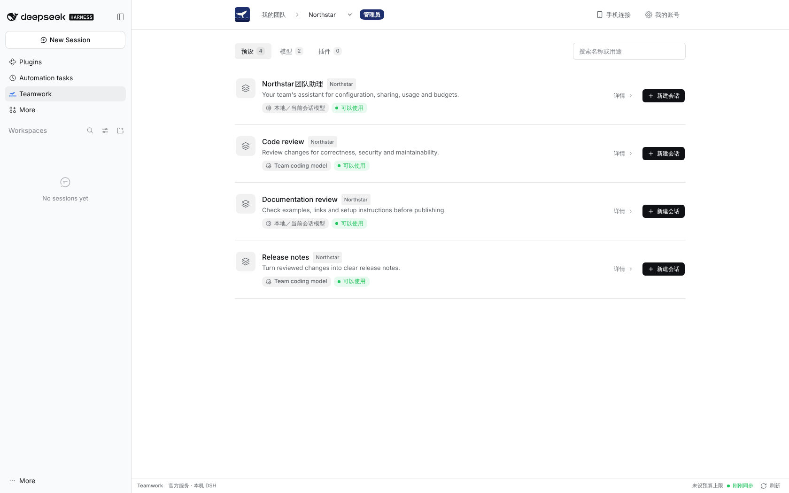
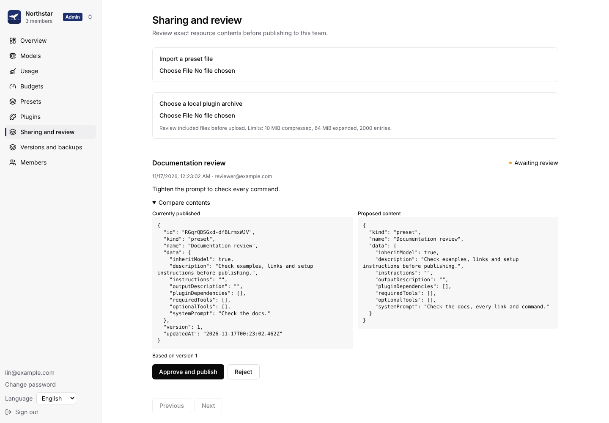

<p align="center"></p>

# DSH Teamwork

English · [简体中文](README.zh-CN.md)

[](https://www.npmjs.com/package/@dsh-teamwork/dsh-teamwork)
[](https://github.com/dsh-teamwork/dsh-teamwork/actions/workflows/ci.yml)
[](LICENSE)

**Shared models, agent presets, and approved plugins for your team's DSH workspace.**

Connect [DeepSeek Harness](https://github.com/deepseek-ai/deepseek-harness) to
[DSH Teamwork](https://www.dshteamwork.com), or your team's self-hosted server.
A team publishes its configuration once; members sync it into their own DSH.
The team assistant helps with sharing, usage and administration in conversation.



The plugin panel and the web console speak English and Simplified Chinese:
the panel follows the language of your Teamwork account (**Account** in the
panel). Terminal `/teamwork` output is always English; model replies follow the
conversation. Screenshots use a local
demonstration team.

## What you can do

| Capability | What it gives your team |
| --- | --- |
| Shared models and presets | Sync team resources and create sessions from native DSH agent presets. |
| Team assistant | Ask about configuration, personal usage and applicable budgets; administrators get their authorized management operations. |
| Reviewed sharing | Prepare local plugin packages and submit new or updated plugins/presets for administrator review. |
| Version history | Inspect publications, export resource backups and prepare a reviewed restoration. |
| Team governance | Administrators manage configuration, budgets and approval through the connected service. |
| Paired device access | With the relay, pair your phone (the Teamwork App) or a browser (My DSH in the web console) to your online DSH computer. |

Sharing and review happen inside the selected team. A publication becomes
available to its members; it does not install code on their computers.

## Install

**DSH Desktop:** open **Plugins → Add plugin** in the application, enter the
package name below, install it and enable it. Follow any restart prompt.

```text
@dsh-teamwork/dsh-teamwork
```

Desktop manages its own profile. Use its plugin manager for installation and
updates; a CLI installation into `web` belongs to a different profile.

**DSH CLI / Web:** install into the profile you actually run:

```sh
dsh plugin --profile web add @dsh-teamwork/dsh-teamwork
dsh web
```

For an existing web process, follow the host's reload/restart instructions.
Replace `web` with your custom profile name where appropriate.

| Requirement | Support |
| --- | --- |
| Declared DSH range | `>=0.2.2-rc.1 <0.3.0-0` |
| CI host versions | `0.2.2-rc.1`, `0.2.2-rc.2`, `0.2.2-rc.3` |
| Node.js | Follow your DSH runtime's requirement; the current RC line requires Node.js 24.9+. Desktop supplies its runtime. |

CI uses Linux and pnpm 9.15.9. Other host and package-manager combinations
follow their own build-script and installation policies. See
[installation troubleshooting](docs/en/guide.md#installation-and-updates).

## Start with your team

1. Open **Teamwork** in the DSH sidebar and choose the browser sign-in action.
2. Sign in to the service and authorize this DSH. Use the displayed fallback
   authorization line if the loopback callback cannot complete.
3. Select a team and refresh its resources. Create or join a team in the web
   console if you have no membership yet.
4. Select the team's assistant preset and create a new session. New teams receive
   an assistant named after the team; existing teams are not automatically changed.

Try asking:

> Sync my team's configuration and show my usage for this month.

The assistant may inherit your session's local model. It needs a working model
to act; inheriting a model does not configure a team gateway route.

## Members and administrators

| Member | Team administrator |
| --- | --- |
| Read shared resources and personal usage; inspect applicable budgets. | Read authorized team usage and manage team/member/provider budgets. |
| Submit presets and local plugin packages, including updates. | Review frozen submissions and publish or reject them. |
| Use published presets and explicitly install approved plugins. | Manage team configuration and prepare historical restorations. |

Mutations use DSH's real approval flow and the server rechecks permissions.
Enter provider keys and account passwords through the console's secure forms.
The [user guide](docs/en/guide.md) covers commands, configuration, device access
and the distinction between submitted, published, synced and installed.



## Service and data

- The default service is `https://www.dshteamwork.com`. Change it on the
  Teamwork sign-in screen to use a [self-hosted community server](https://github.com/dsh-teamwork/dsh-teamwork-platform).
- Team-model requests go through your chosen server. Provider keys stay on
  that server; prompts and model context pass through its model gateway.
- The sign-in is kept beside the cache (`<cache>.token.json`, readable only by
  you), so restarting DSH keeps you signed in. It lapses after 30 days unused,
  and `/teamwork logout` revokes it on the server too. Configuration caches do
  not authenticate a session.
- The device relay requires an online web/desktop host, and on a phone the
  matching App. Pairing grants
  access to the owner's permitted DSH sessions across teams.

[Data, device pairing and recovery details](docs/en/guide.md#data-and-device-access)
explain which information is local, which reaches your server, and what the
paired channel protects.

## Help and development

- [User guide](docs/en/guide.md) · [中文使用指南](docs/zh-CN/guide.md)
- [Developer reference](docs/development.md) — build, host checks, runtime behavior and publishing.
- [Report an issue](https://github.com/dsh-teamwork/dsh-teamwork/issues) — include DSH/plugin versions, platform, profile type and a redacted error.
- [Teamwork service](https://www.dshteamwork.com) · [Community server](https://github.com/dsh-teamwork/dsh-teamwork-platform)

## License

[Apache License 2.0](LICENSE). The DSH Teamwork name and whale mark are covered
by [NOTICE](NOTICE); a fork uses its own branding.
