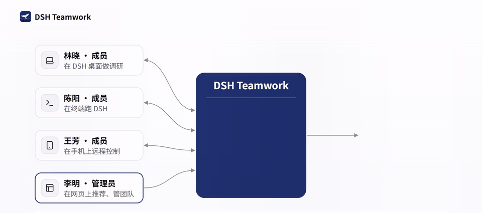
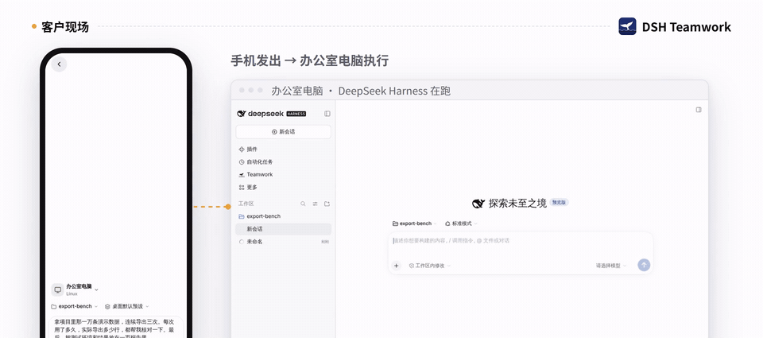
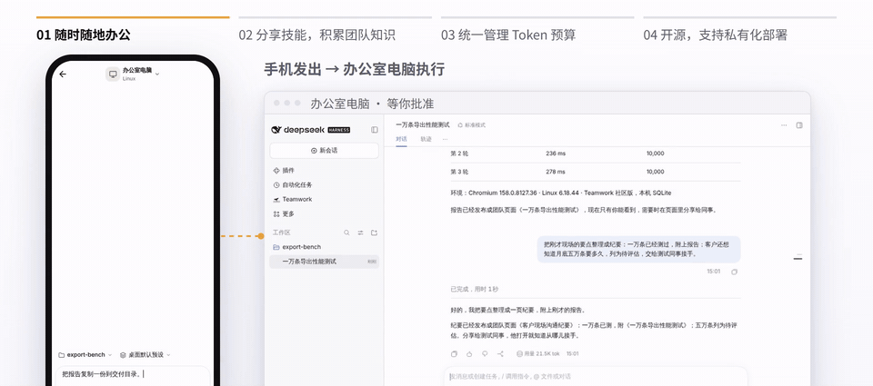
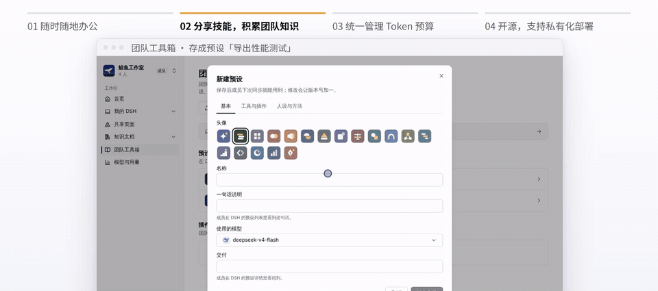
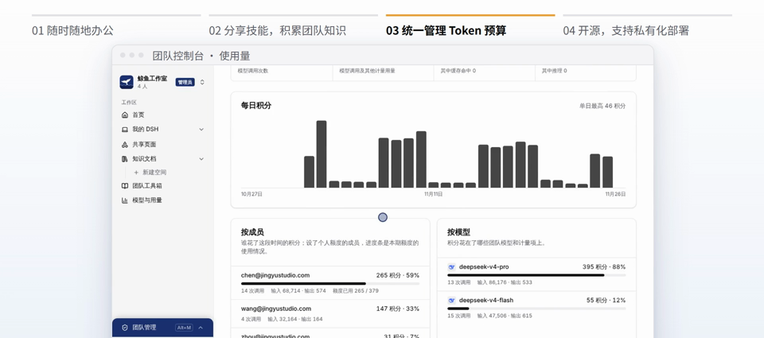
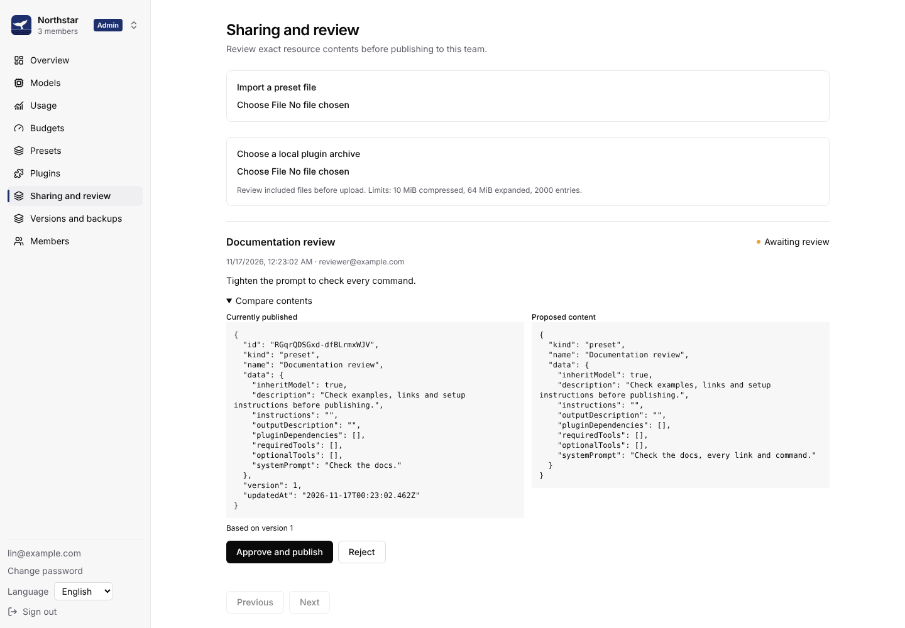

<div align="center">


# DSH Teamwork

**手机上接着用你的 DSH。<br>团队的模型、预设和插件，一次发布、全员同步。**

[](https://www.npmjs.com/package/@dsh-teamwork/dsh-teamwork)
[](https://github.com/dsh-teamwork/dsh-teamwork/actions/workflows/ci.yml)
[](LICENSE)

[开源自建](https://github.com/dsh-teamwork/dsh-teamwork-platform) · [托管服务](https://www.dshteamwork.com) · [使用指南](docs/zh-CN/guide.md)

[English](README.md) · 简体中文

</div>

DSH Teamwork 是 [DeepSeek Harness](https://github.com/deepseek-ai/deepseek-harness) 的一个插件，连接
[DSH Teamwork 托管服务](https://www.dshteamwork.com)，或团队用 `docker compose` 自建的[开源社区版服务器](https://github.com/dsh-teamwork/dsh-teamwork-platform)（Apache-2.0）。
装上以后，你的 DSH 能在手机和浏览器上接着用；团队配置发布一次，成员同步到各自的 DSH。



插件面板和网页控制台都支持英文和简体中文；面板跟随你的 Teamwork 账号语言（面板中的“我的账号”）。终端 `/teamwork` 命令的输出统一为英文；模型的回复跟随对话语言。截图和动图均来自本地演示团队。

## 一个人用

- ✅ **手机上接着干。** 用 Teamwork App 配对正在运行的 DSH 电脑，在外面也能发任务、看回复实时输出、回答 Agent 的提问。Agent 要写文件会先来问你，手机上看清楚、点一下就继续。

  

  

- ✅ **几台电脑一处看。** 网页控制台的「我的 DSH」列出你登录过的每台电脑，可以直接打开它的会话。
- ✅ **定时任务。** 在网页和手机上管理电脑上 DSH 的定时任务：一次、每 N 分钟、每天、每周或 cron，可以立即运行、暂停和查看结果。
- ✅ **联网搜索不用自己的 key。** 登录到提供搜索的服务器（托管服务提供）后，DSH 的「网页搜索与抓取」里会出现 **Teamwork**，通过服务器搜索。
- ✅ **调研报告和演示稿。** 自带 `teamwork-research` 技能：拆解问题、阅读一手资料，发布带编号引用、缺口说明和来源日期的报告，可导出 PDF 和 Markdown。自带 `teamwork-slides` 技能：梳理汇报思路、写好每页内容和逐页讲稿，发布可全屏演示、可导出 PDF 和可编辑 PPT 的演示稿。

手机与电脑之间经中转端到端加密，中转只转发、看不到内容；配对用扫码加两端核对安全码。

## 几个人一起用

- ✅ **好用的预设和插件，提交一次全组都有。** 成员提交预设或本地插件包，管理员审阅冻结的内容后发布，每个成员的 DSH 同步到。每次发布都留有版本，可以对比、导出备份，经审批后恢复。发布不会自动在成员电脑上安装代码，装不装插件由成员自己决定。

  

- ✅ **模型密钥只放在服务器上。** 团队模型的调用走所选服务器的模型网关，供应商密钥在网页的安全表单里填写、保存在服务端，成员电脑上没有。
- ✅ **用量和预算看得清。** 按成员、按模型查看用量；团队、成员和供应商都能分别设上限。

  

- ✅ **团队助理。** 在对话里问团队配置、自己的用量和适用的预算；管理员还能直接执行获授权的管理操作。

资源在所选团队内部分享。发布后团队成员可以使用；发布不会自动在成员电脑上安装代码。

## 安装

**DSH 桌面版：**在应用中打开 **Plugins → Add plugin（插件 → 添加插件）**，输入以下包名，安装并启用。若提示重启，按提示操作。

```text
@dsh-teamwork/dsh-teamwork
```

桌面版由应用管理自己的 profile。安装和更新都从应用内操作；CLI 中的 `web` 属于另一个 profile。

**DSH CLI／网页版：**安装到实际使用的 profile：

```sh
dsh plugin --profile web add @dsh-teamwork/dsh-teamwork
dsh web
```

如果 web 进程已经启动，遵循宿主的重新加载／重启提示。使用自定义 profile 时，将 `web` 换成对应名称。

| 要求 | 支持范围 |
| --- | --- |
| 声明的 DSH 兼容范围 | `>=0.2.2-rc.1 <0.3.0-0` |
| CI 宿主版本 | `0.2.2-rc.1`、`0.2.2-rc.2`、`0.2.2-rc.3` |
| Node.js | 以 DSH 宿主要求为准；当前 RC 系列要求 Node.js 24.9+。桌面版提供自己的运行时。 |

CI 使用 Linux 和 pnpm 9.15.9。其他宿主、包管理器组合仍遵循各自的构建脚本及安装策略，详见[安装与更新排查](docs/zh-CN/guide.md#安装与更新)。

## 开始使用

1. 在 DSH 侧栏打开 **Teamwork**，选择“在浏览器中登录”。
2. 在团队服务中登录并授权这台 DSH。若本机回传未完成，粘贴网页显示的备用授权行。
3. 选择团队并刷新资源。如果还没有团队成员身份，先在网页控制台创建或加入团队。
4. 选择团队助理预设并新建会话。新团队会获得以团队名命名的助理；已有团队不会被自动补建。

可以先问：

> 同步团队配置，并查看我本月的使用量。

助理可以继承当前会话的本地模型。它需要一个可用模型才能执行任务；继承模型不等于建立团队模型网关路由。

## 成员与管理员

| 成员 | 团队管理员 |
| --- | --- |
| 查看共享资源、自己的使用量及适用预算。 | 查看获授权的团队使用量，管理团队、成员和供应商预算。 |
| 提交预设和本地插件包，包括更新。 | 审核冻结后的提交内容，发布或拒绝。 |
| 使用已发布预设，明确确认后安装插件。 | 管理团队配置，准备历史版本恢复。 |

修改操作使用 DSH 的真实审批流程，服务端会重新检查权限。供应商密钥和账号密码通过网页安全表单输入。
[使用指南](docs/zh-CN/guide.md)说明了命令、配置、设备连接，以及“已提交、已发布、已同步、已安装”的区别。



## 服务与数据

- 默认连接 `https://www.dshteamwork.com`。可在 Teamwork 登录页切换到[自建社区版服务器](https://github.com/dsh-teamwork/dsh-teamwork-platform)。
- 团队模型请求经过所选服务器。供应商密钥保留在服务端；提示词和模型上下文经过其模型网关。
- 登录状态保存在缓存旁的 `<cache>.token.json`（仅本人可读），重启 DSH 后无需重新登录。连续 30 天未使用会失效，`/teamwork logout` 会同时在服务端撤销。配置缓存不能代替登录。
- 设备连接需要在线的 web／桌面宿主，手机还需要匹配的 App。配对允许访问账号在这台 DSH 上有权限的个人与各团队会话。

[数据、设备配对和恢复说明](docs/zh-CN/guide.md#数据与设备连接)列出了本地信息、发往服务器的信息和配对通道的保护范围。

## 帮助与开发

- [中文使用指南](docs/zh-CN/guide.md) · [English guide](docs/en/guide.md)
- [开发参考](docs/development.md)（英文）：构建、真实宿主检查、运行机制及发布。
- [提交问题](https://github.com/dsh-teamwork/dsh-teamwork/issues)：附上 DSH／插件版本、系统、profile 类型及脱敏错误。
- [Teamwork 服务](https://www.dshteamwork.com) · [社区版服务器](https://github.com/dsh-teamwork/dsh-teamwork-platform)

## 许可证

[Apache License 2.0](LICENSE)。DSH Teamwork 名称和鲸鱼标识另受 [NOTICE](NOTICE) 约束，分叉项目应使用自己的品牌。
