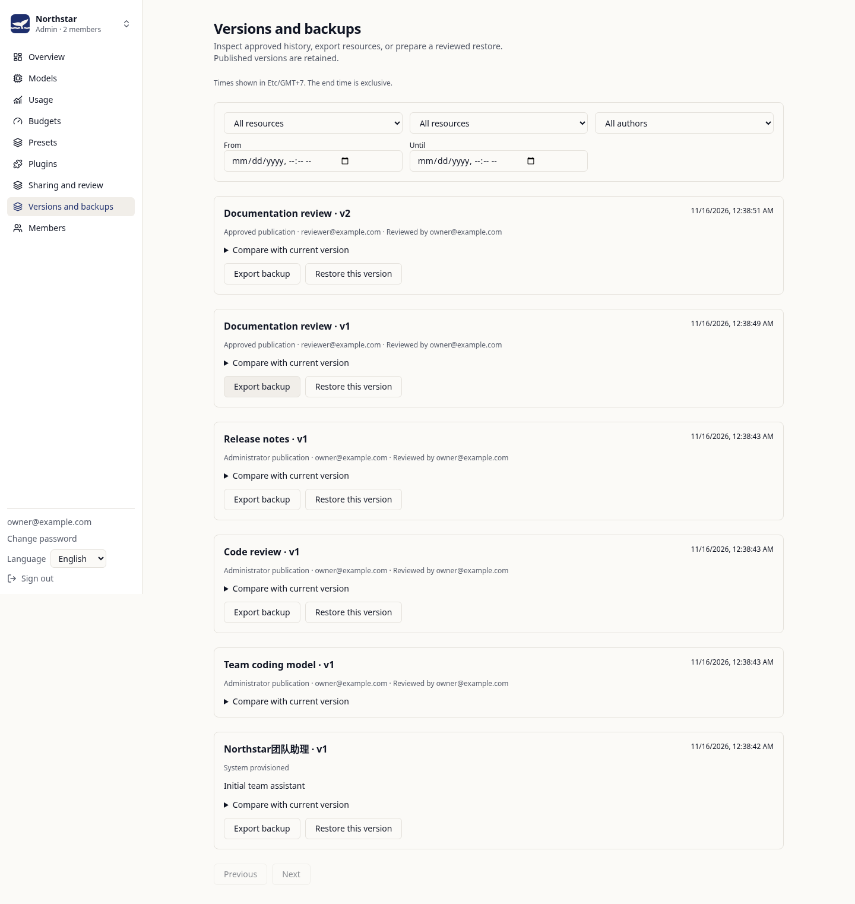

# Using DSH Teamwork

[README](../../README.md) · [简体中文](../zh-CN/guide.md)

Connect a DSH host to your team's service, sync resources, then choose a preset
for a new conversation. Teamwork resources are additive: local configuration
and local default models remain independent.

## Installation and updates

Use the desktop application's **Plugins → Add plugin** for a Desktop profile.
For a CLI web profile use `dsh plugin --profile web add @dsh-teamwork/dsh-teamwork`.
Use the same profile's plugin manager for updates, enabling and diagnostics.
Follow its reload/restart prompts. On the CLI, update with
`dsh plugin --profile web update --latest @dsh-teamwork/dsh-teamwork`; without
`--latest`, a new minor version (0.11 after 0.10) is not picked up.

- **Version rejected:** check the installed plugin and DSH versions. The declared
  range is `>=0.2.2-rc.1 <0.3.0-0`; CI covers rc.1, rc.2 and rc.3. Install a
  compatible published version. A range is a declaration, not a test of every
  future release.
- **A new release is not selected:** some hosts apply a minimum release age.
  Select an exact version that is already visible on the
  [npm versions page](https://www.npmjs.com/package/@dsh-teamwork/dsh-teamwork?activeTab=versions).
  A version in GitHub's main branch may still await npm publication.
- **Build scripts await a decision:** pnpm 11 can stop for dependency scripts.
  Use your host's build review. In an isolated Linux CLI check, explicitly
  denying the `@google/genai` and `protobufjs` scripts allowed installation and
  the basic integration checks to pass. This is separate from DSH compatibility.
- **Installed, but missing in Desktop:** a `web` CLI install does not change
  Desktop's profile. Install through the application.
- **DSH fails after an older plugin install:** earlier packages could install
  their own DSH core dependencies into a hoisted profile. Back up the profile,
  upgrade the plugin and reinstall the profile dependencies using the host's
  recovery flow. Disabling the old plugin alone does not remove those packages.

## Sign in and select a team

Open Teamwork and choose the browser sign-in action. The plugin starts a
loopback callback for up to ten minutes. If the callback is inaccessible,
copy the authorization line shown by the service into the panel or DSH command
input. The one-use authorization code expires after two minutes.

Authorization immediately syncs resources; by default the plugin refreshes
every 60 seconds. Use the team selector to browse one team or all teams.
Browsing another team does not retarget an existing conversation or restrict
phone pairing to that team. A person may belong to several teams.

Create or join teams in the web console. New teams receive a built-in assistant;
existing teams are unchanged. Team renaming does not automatically rename the
assistant. It leads the panel's presets: **Ask the assistant** starts a session
with it. Give it a working model and ask it to inspect real state. While an
administrator browses a team, the panel's header shows how many submissions wait
for review and opens them in the console.

### A team's shared DSH

On the hosted service a team admin can make one DSH the team's own: create a
key under **Shared DSHs** in the team's console, then run
`/teamwork share enable <key>` in that DSH. It then signs in as the team, not as
a person: personal sign-in is refused while it is shared, it syncs that one
team, and its team-model calls are billed to the team. The first machine that
uses a key keeps it; the same key on another machine is refused, and an admin
who rotates or deletes the key cuts it off. `/teamwork share disable` deletes
the key. A team admin chooses in the console who may reach it; for each of
them, run `/teamwork share invite <email>` here and hand the link over in
person or through a channel the team trusts, never through the Teamwork server.
Each member's sessions are theirs alone: others cannot list, follow or answer
them. A member opens the link in the DSH Teamwork phone app, or pastes it under
**Shared DSHs** in the team console.

A shared DSH admits nobody until its admin sets the team's audit key. On their
own computer the admin runs `dsh-teamwork-audit keygen` (from
`npm install -g @dsh-teamwork/dsh-teamwork`), which writes `audit-key.json` and prints
`/teamwork share audit-key <public key>` to run here. From then on this DSH
seals every exchange with a member's device to that key and uploads it; the
server keeps it and cannot read it. The admin downloads it from the console and
opens it with `dsh-teamwork-audit read <file> --key audit-key.json`. A lost key
cannot be recovered.

Everything above can also be done in the Teamwork panel: **Use this DSH as a
team's shared DSH** on its sign-in screen or account page turns shared mode on,
and its **Shared DSH** page then sets the audit key, lists the members who may
reach it with their devices, makes an invite (a link and a QR code), unlocks a
member locked out by wrong PINs, and turns shared mode off.

On a server with no browser, `dsh-teamwork` does the same from a shell on that
machine, while DSH runs there as the same user. The copy inside DSH's profile is
not on your `PATH`, so install the commands once (and again after an update):
`npm install -g @dsh-teamwork/dsh-teamwork`.

```sh
dsh-teamwork server https://teamwork.example.com   # a self-hosted team only, before enabling
dsh-teamwork share enable <key>
dsh-teamwork share audit-key <public key>
dsh-teamwork share invite alice@example.com
dsh-teamwork share members        # also: status, unlock <email>, disable
```

It reaches the running DSH through a socket in the plugin's directory in the DSH
home (below), which only that user can open. It runs on Linux and macOS.

A personal DSH on a server works the same way: `dsh-teamwork login` prints a
sign-in link to open in any browser, and `dsh-teamwork authorize <code>` takes
the code the page shows. `dsh-teamwork status` and `dsh-teamwork sync` follow
the team's configuration. `dsh-teamwork phone pair` draws the phone app's
pairing QR code in the terminal. `dsh-teamwork phone list` then shows the
waiting phone's safety code. When the phone shows the same code,
`dsh-teamwork phone accept <id>` accepts it; `reject` and `revoke` refuse or
remove one.

## Choose a model or preset

Use **New session** for a team preset. **Use in this blank session** works only
before the conversation begins. Started sessions keep their preset generation;
use a new session to adopt an update. A restart cannot promise to reconstruct a
deleted old preset: a version mismatch blocks team inference and gives recovery
guidance.

Required tools and pinned plugin dependencies must be available. Optional
missing tools are warnings. A registered tool still follows DSH's authorization
and runtime conditions. Team model routes go through your service; a preset
that inherits a local model keeps that model instead.

## Share, review and restore

1. Ask the team assistant to prepare a plugin inside the session workspace,
   or submit a preset/plugin through **Sharing and review** in the web console.
2. Review the prepared package identity, version, file list and SHA-256 before
   upload. Preparation does not run package lifecycle scripts.
3. Submit the new resource or update for administrator review. An update names
   the existing configuration and its base version.
4. An administrator inspects the frozen contents and approves or rejects them.
   A conflicting newer publication requires a fresh submission.
5. Members sync the published resource. A plugin still needs a separate local
   installation confirmation; existing local packages are not silently upgraded.

Members see their own submissions. Administrators see the team's submissions.
Assistant writes also need host approval, including for administrators.
Provider secrets and new account passwords belong in the console's forms.

**Versions and backups** shows publication time, author/approver, changes and
retained versions. Exported resources can include retained private plugin bytes.
A restoration prepares a new publication for review; it does not erase history
or replace a running conversation's preset. A resource export is distinct from
a full database-and-artifact backup managed by the server operator.



## Commands

Run these in DSH's command input, not your shell. IDs come from `/teamwork list`.

| Command | Purpose |
| --- | --- |
| `/teamwork login` | Open browser authorization. |
| `/teamwork authorize <code>` | Redeem a fallback authorization code. |
| `/teamwork share enable <key>` | Make this DSH its team's shared DSH with a team host key (hosted service). |
| `/teamwork share disable` | End shared mode and delete its key. |
| `/teamwork share status` | Show the shared DSH's name, team and host token. |
| `/teamwork share invite <email>` | A single-use link, valid a day, that pairs one listed member's device with this shared DSH. |
| `/teamwork share members` | The members who may reach this shared DSH, and their devices. |
| `/teamwork share unlock <email>` | Clear a member's PIN and lock on this shared DSH; they set a new PIN next time. |
| `/teamwork share audit-key <key>` | Seal this shared DSH's archive to the key `dsh-teamwork-audit keygen` printed; members are admitted only once it is set. |
| `/teamwork pin reset` | Clear your own phone PIN and lock on this computer; set a new one from your phone. |
| `/teamwork status` | Show authentication, sync status and recent errors. |
| `/teamwork sync` | Refresh the team's resources. |
| `/teamwork list` | List configuration IDs. |
| `/teamwork info [id]` | Inspect active or available preset details and readiness. |
| `/teamwork new <id>` | Create a session from the latest preset without starting a task. |
| `/teamwork use <id>` | Select a team resource in a blank session. |
| `/teamwork tools` | Inspect visible tool names and conditions. |
| `/teamwork plugins [presetId]` | Check published plugin dependencies. |
| `/teamwork install <id>[@<version>]` | Preview an exact plugin installation; repeat with `confirm` after inspection. |
| `/teamwork session [check]` | Inspect session state; `check` refreshes team access/readiness. |
| `/teamwork continue <instruction>` | Send follow-up input after readiness checks. |
| `/teamwork cancel` | Request native cancellation; keep the inbox and existing file changes. |
| `/teamwork retry` | Preview recovery; `retry confirm` sends a recovery instruction, not tool replay. |
| `/teamwork logout` | Drop the in-memory token, team cache and team registrations. |

Continue and retry do not jump ahead of queued input. A confirmation expires
when its session, model, configuration or login binding changes. Logout leaves
explicitly installed plugins in place. Removed members are refused by the
server on their next request.

## Configuration

The default server is `https://www.dshteamwork.com`. Change it on the sign-in
screen to a self-hosted server. HTTPS is required except on loopback. Changing
servers signs you out and clears the previous server's team resources.

The plugin keeps its sign-in, team cache and, on a shared DSH, its key, member
list, PIN locks and archive queue in `dsh-teamwork/` in the DSH home
(`$DSH_HOME`, else `~/.dsh`), wherever DSH was started.

Advanced profile configuration can override the inserted plugin entry:

```yaml
- id: dsh-teamwork
  config:
    apiEndpoint: https://teamwork.example.com
    cachePath: /absolute/path/to/private/teamwork-cache.json
    autoSync: true
    syncIntervalMs: 60000
```

`syncIntervalMs` accepts integer milliseconds from 10000 to 86400000.
`autoSync: false` disables login-triggered and periodic sync; manual sync remains.

A host that signs DSH in itself, such as a DSH Teamwork cloud computer, sets
`tokenFile` to the absolute path of a file holding a plugin token. The plugin
reads it at start and follows every change, including an atomic replacement;
an empty or missing file signs it out. In this mode sign-in, sign-out and
changing servers are refused, `apiEndpoint` names the server, and the phone
relay is never opened.
Do not duplicate the package's `insert` entry in a profile.

## Data and phone access

Tokens stay in host memory; restart requires sign-in. Team configuration is
cached with private file permissions. A stale cache is not authorization.
Network failures preserve it; 401/403 clear team registrations and suspend sync
until sign-in. Provider keys remain on the service; team-model prompts and
context travel through that service's gateway.

The hosted service may advertise a relay. A matching Teamwork App and an online
DSH web/desktop host are required. Headless-only hosts return 503 for phone
requests. The community edition does not supply the hosted relay.

Pairing requires matching account identity, checking the safety code on both
devices and approval on the computer. It authorizes the owner's permitted
personal and team sessions on this DSH, across teams. It grants no additional
team permissions. A private, authenticated encrypted channel protects phone
requests and ordinary file attachments; the relay can still see account/device
metadata, public keys, timing and sizes. The team-model gateway is a separate
boundary. Both endpoints must be on matching protocol versions.

Pairing keys persist locally. Changed or missing trusted keys require pairing
again. Desktop revocation closes the channel immediately; phone-side revocation
needs the computer's encrypted acknowledgement and may wait for reconnection.

## Getting help

Use `/teamwork status`, the local plugin manager and your server's console.
Include DSH/plugin versions, OS, profile type, package-manager version and
redacted diagnostics in an [issue](https://github.com/dsh-teamwork/dsh-teamwork/issues).
Remove tokens, authorization lines, pairing codes, provider keys and private
team data before posting. [Developer details](../development.md) cover tests and protocols.
