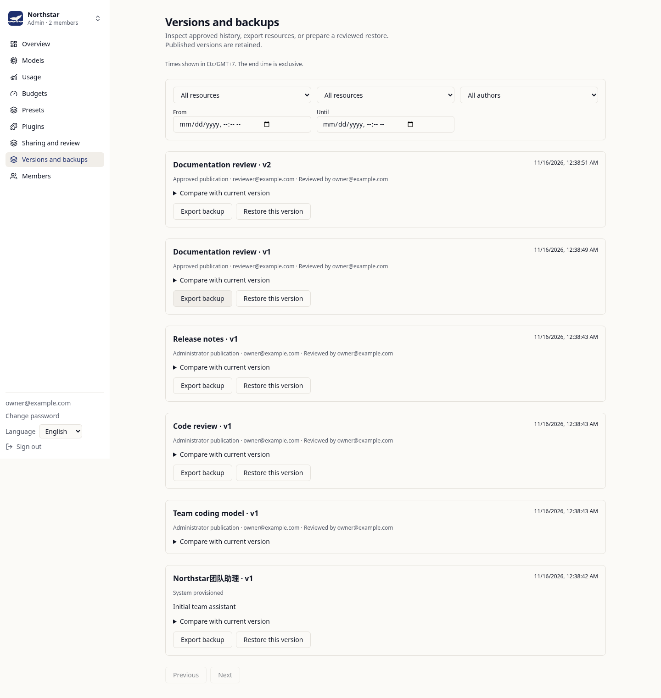

# 使用 DSH Teamwork

[中文 README](../../README.zh-CN.md) · [English](../en/guide.md)

连接团队服务、同步资源，再为新会话选择预设。团队资源以增量方式加入 DSH，本地配置和默认模型继续独立使用。

## 安装与更新

桌面版从应用内 **Plugins → Add plugin** 安装；CLI web profile 使用
`dsh plugin --profile web add @dsh-teamwork/dsh-teamwork`。更新、启用及诊断也应通过同一个 profile 的插件管理器，遵循宿主的重载／重启提示。CLI 用 `dsh plugin --profile web update --latest @dsh-teamwork/dsh-teamwork` 更新；不加 `--latest` 时，0.10 之后的 0.11 这样的新版本不会被装上。

- **版本被拒绝：**核对 DSH 与插件版本。声明范围为 `>=0.2.2-rc.1 <0.3.0-0`，CI 覆盖 rc.1、rc.2、rc.3。选择兼容且已发布的插件版本；范围声明不代表实测过所有未来版本。
- **没有选到刚发布的版本：**部分宿主应用最短发布时间策略。可在 [npm 版本页](https://www.npmjs.com/package/@dsh-teamwork/dsh-teamwork?activeTab=versions)核实后指定精确版本。GitHub main 中的版本可能仍在等待 npm 发布。
- **构建脚本等待处理：**pnpm 11 可能因依赖脚本暂停安装，使用宿主的构建审核流程。本地隔离 Linux CLI 检查中，明确拒绝 `@google/genai`、`protobufjs` 的脚本后，安装和基础集成检查通过；这与 DSH 版本兼容检查是两件事。
- **安装成功但桌面版没有出现：**CLI 的 `web` profile 不属于桌面应用，应在应用内安装。
- **旧版安装后 DSH 启动失败：**早期插件可能把自己的 DSH 核心包安装到 hoisted profile，覆盖升级后的宿主。先备份 profile，通过宿主恢复流程升级插件并重新安装依赖；仅停用旧插件不会清除这些包。

## 登录与选择团队

在 Teamwork 中选择浏览器登录。插件会启动最多十分钟的本机回传监听；无法回传时，把网页显示的授权行粘贴到面板或 DSH 命令输入框。一次性授权码有效期为两分钟。

授权完成后立即同步，默认每 60 秒刷新。用团队下拉框浏览一个或所有团队；改变浏览范围不改变已有会话的目标团队，也不能把手机授权限制到这个团队。一个账号可以加入多个团队。

在网页控制台创建或加入团队。新团队会获得内置助理，已有团队不自动补建；重命名团队不会自动重命名助理。助理排在面板预设的最前面，点击“问问助理”即可用它新建会话。为助理选择可用模型后，要求它读取真实状态再操作。管理员浏览某个团队时，面板顶部会显示待审核的提交数量，点击即可在控制台打开。

### 团队 DSH

团队管理员可以把一台 DSH 设为团队自己的：在团队控制台的**团队资产 → 团队 DSH**里创建 key，再在那台 DSH 中运行 `/teamwork share enable <key>`。之后它以团队身份登录而不是个人：作为团队 DSH 期间拒绝个人登录，只同步这一个团队，团队模型的调用计入团队。第一台使用 key 的机器会绑定它，同一个 key 换到其他机器上会被拒绝；管理员更换或删除 key 后它立即失效。`/teamwork share disable` 会删除 key。团队管理员在控制台决定谁可以访问它；对其中每个人，在这里运行 `/teamwork share invite <email>`，并当面或通过团队信任的渠道交给对方，不要经过 Teamwork 服务器。每个成员的会话只属于自己，其他人无法查看、跟随或回答。成员在 DSH Teamwork 手机 App 中打开链接，或在团队控制台的**工作区 → 团队 DSH**中粘贴。

团队 DSH 在管理员设置团队审计密钥之前不会接纳任何人。管理员在自己的电脑上运行 `dsh-teamwork-audit keygen`（由 `npm install -g @dsh-teamwork/dsh-teamwork` 安装），它会写出 `audit-key.json` 并打印要在这里运行的 `/teamwork share audit-key <public key>`。此后这台 DSH 会把与成员设备之间的每次交互加密到这把密钥并上传，服务器保存它却无法读取。管理员在控制台下载归档，用 `dsh-teamwork-audit read <file> --key audit-key.json` 打开。丢失的密钥无法找回。

以上操作也都可以在 Teamwork 面板中完成：在登录页或账号页选择**把这台 DSH 设为团队 DSH** 即可开启；开启后的**团队 DSH** 页可以设置审计密钥、查看可访问的成员及其设备、生成邀请（链接和二维码）、为输错 PIN 被锁定的成员解锁，以及让它不再作为团队 DSH。

在没有浏览器的服务器上，可以用 `dsh-teamwork` 在那台机器的终端里完成同样的操作，前提是 DSH 正以同一个用户在那里运行。DSH profile 里的那一份不在 `PATH` 上，所以先安装一次命令（更新插件后再装一次）：`npm install -g @dsh-teamwork/dsh-teamwork`。

```sh
dsh-teamwork server https://teamwork.example.com   # 仅自托管团队，在开启前设置
dsh-teamwork share enable <key>
dsh-teamwork share audit-key <public key>
dsh-teamwork share invite alice@example.com
dsh-teamwork share members        # 另有 status、unlock <email>、disable
```

它通过 DSH home 里插件目录下的一个 socket 连接正在运行的 DSH（见下文），只有该用户能打开。支持 Linux 和 macOS。

服务器上的个人 DSH 也一样：
- **登录**：`dsh-teamwork login` 打印登录链接，在任意浏览器中打开，再用 `dsh-teamwork authorize <code>` 填入页面上显示的授权码。
- **同步**：`dsh-teamwork status` 和 `dsh-teamwork sync` 查看并同步团队配置。
- **配对手机**：`dsh-teamwork phone pair` 在终端里画出手机 App 的配对二维码，`dsh-teamwork phone list` 显示等待中手机的安全码，与手机上的一致时用 `dsh-teamwork phone accept <id>` 确认；`reject` 和 `revoke` 用于拒绝或移除。

## 选择模型或预设

使用“新建会话”应用团队预设。“用于当前空白会话”仅适用于尚未开始对话的会话。已开始的会话保留原预设代次，使用新会话采用更新。跨重启不保证重建已删除的旧预设；发现版本不一致时会阻止团队推理并给出恢复指引。

必需工具和固定版本的插件依赖必须就绪，可选工具缺失只提示。工具已注册仍须满足 DSH 授权与运行条件。团队模型经过团队服务；继承本地模型的预设继续使用所继承的模型。

## 分享、审批与恢复

1. 让团队助理准备会话工作区内的插件，或在网页“分享与审批”中提交插件／预设。
2. 上传前检查包名、版本、文件清单和 SHA-256。准备包时不运行生命周期脚本。
3. 提交新增或更新；更新须关联现有配置及其基础版本。
4. 管理员检查冻结内容并批准或拒绝；如已有更新版本发布，需要重新提交。
5. 成员同步已发布资源。插件仍需本机安装确认，不会静默升级已有本地包。

成员查看自己的提交，管理员查看团队提交。管理员通过助理写入时也需要宿主审批。供应商密钥和新账号密码通过网页安全表单输入。

“版本与备份”显示发布时间、作者／审批人、变更和保留版本。导出资源可包含保留的私有插件文件；恢复会准备一个新的待审核发布，不会抹去历史或替换运行中会话的预设。资源导出不同于运维人员管理的完整数据库与插件文件备份。



## 命令

在 DSH 命令输入框中运行，不是在系统 shell 中。ID 可通过 `/teamwork list` 查看。

| 命令 | 用途 |
| --- | --- |
| `/teamwork login` | 打开浏览器授权。 |
| `/teamwork authorize <code>` | 兑换备用授权码。 |
| `/teamwork share enable <key>` | 用团队授权 key 把这台 DSH 设为团队 DSH。 |
| `/teamwork share disable` | 关闭共享模式并删除 key。 |
| `/teamwork share status` | 查看团队 DSH 的名称、团队和 token 状态。 |
| `/teamwork share invite <email>` | 生成一次性邀请链接（一天内有效），让名单中的一位成员把设备配对到这台团队 DSH。 |
| `/teamwork share members` | 查看可访问这台团队 DSH 的成员及其设备。 |
| `/teamwork share unlock <email>` | 清除某个成员在这台团队 DSH 上的 PIN 和锁定，对方下次连接时重新设置。 |
| `/teamwork share audit-key <key>` | 把这台团队 DSH 的归档加密到 `dsh-teamwork-audit keygen` 打印的密钥；设置之后才会接纳成员。 |
| `/teamwork pin reset` | 清除你自己手机在这台计算机上的 PIN 和锁定，再从手机设置新的。 |
| `/teamwork status` | 查看登录、同步和最近错误。 |
| `/teamwork sync` | 刷新团队资源。 |
| `/teamwork list` | 列出配置 ID。 |
| `/teamwork info [id]` | 检查当前或可选预设的说明与就绪状态。 |
| `/teamwork new <id>` | 从最新预设创建会话，不直接启动任务。 |
| `/teamwork use <id>` | 在空白会话中选择团队资源。 |
| `/teamwork tools` | 查看可见工具名和条件。 |
| `/teamwork plugins [presetId]` | 检查已发布插件依赖。 |
| `/teamwork install <id>[@<version>]` | 预览精确版本安装，检查后追加 `confirm` 确认。 |
| `/teamwork session [check]` | 查看会话状态；`check` 额外刷新团队权限和就绪状态。 |
| `/teamwork continue <instruction>` | 检查后发送后续指令。 |
| `/teamwork cancel` | 请求原生取消，保留待处理输入与已产生的文件修改。 |
| `/teamwork retry` | 预览恢复；`retry confirm` 发送恢复指令，不重放工具调用。 |
| `/teamwork logout` | 丢弃内存令牌、团队缓存与注册。 |

继续和重试不会插队；会话、模型、配置或登录身份变化会使确认失效。退出不卸载明确安装过的插件；被移除成员的下一次服务端请求将被拒绝。

## 配置

默认服务器为 `https://www.dshteamwork.com`，可在登录页改为自建服务。除本机回环地址外须使用 HTTPS。切换服务器会退出登录并清除旧服务器的团队资源。

插件把登录状态、团队缓存，以及团队 DSH 的 key、成员名单、PIN 锁定和归档队列保存在 DSH home（`$DSH_HOME`，否则 `~/.dsh`）下的 `dsh-teamwork/` 中，与从哪个目录启动 DSH 无关。

高级 profile 配置可覆盖已插入的插件条目：

```yaml
- id: dsh-teamwork
  config:
    apiEndpoint: https://teamwork.example.com
    cachePath: /absolute/path/to/private/teamwork-cache.json
    autoSync: true
    syncIntervalMs: 60000
```

`syncIntervalMs` 接受 10000–86400000 之间的整数毫秒。`autoSync: false` 关闭登录触发与定时同步，手动同步仍可用。不要重复复制包内的 `insert` 条目。

由宿主自行为 DSH 登录的环境（例如 DSH Teamwork 云电脑）可以把 `tokenFile` 设为一个文件的绝对路径，文件内容是插件令牌。插件启动时读取它，并跟随之后的每次变化（包括原子替换）；文件为空或不存在即视为退出登录。此模式下不能在插件里登录、退出或切换服务器，服务器由 `apiEndpoint` 指定，也不会连接手机中转。

## 数据与手机连接

令牌只在宿主内存中保存，重启需要登录；团队配置以私有文件权限缓存。旧缓存不是登录授权。网络失败时保留缓存；401／403 会清除团队注册并暂停同步，等待重新登录。供应商密钥保留在服务端，团队模型的提示词与上下文经过其网关。

托管服务可提供中转，需要匹配的 Teamwork App 与在线的 DSH web／桌面宿主。仅启动 headless 的主机对手机请求返回 503；社区版不提供托管中转。

配对需要相同账号、两端核对安全码并在电脑批准。配对可访问本机账号有权限的个人和各团队会话，不增加团队权限。私有认证加密通道保护手机请求与普通附件；中转仍可见账号／设备元数据、公钥、时间和大小。团队模型网关是另一条数据边界；两端须使用匹配协议版本。

配对密钥保存在本机。信任密钥变化或丢失时需要重新配对。电脑解除配对会立即关闭通道；手机端解除需要电脑的加密确认，离线电脑需要重新连线。

## 获取帮助

查看 `/teamwork status`、本地插件管理器和团队服务控制台。向 [Issues](https://github.com/dsh-teamwork/dsh-teamwork/issues) 提供 DSH／插件版本、系统、profile 类型、包管理器版本和脱敏诊断。公开前移除令牌、授权行、配对码、供应商密钥及私有团队数据。构建、测试及协议见[开发参考](../development.md)。
